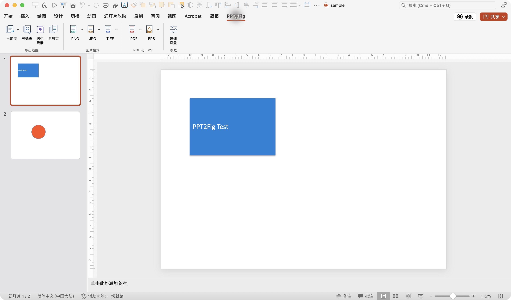
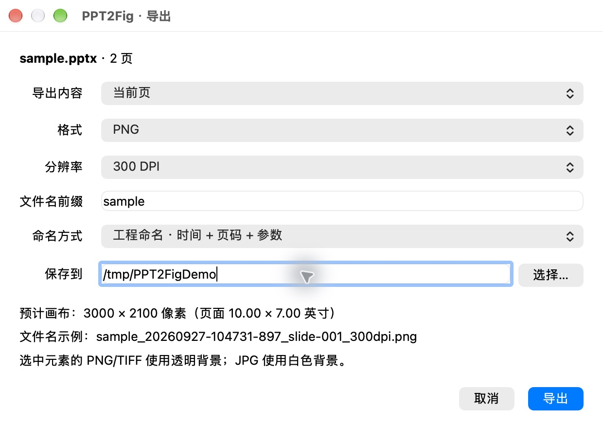

# PPT2Fig

**Export PowerPoint slides and selected objects as images, PDFs, and EPS files for research figures, papers, and engineering documents.** Choose DPI or pixel dimensions, export vector PDFs, preserve transparent backgrounds, and batch selected slides. Processing stays on your computer.

[中文说明](README.md) · [Download v1.0.0](https://github.com/windycn/PPT2Fig/releases/tag/v1.0.0) · [License](LICENSE) · [Third-party notices](THIRD_PARTY_NOTICES.md)

> **Compatibility status:** v1.0.0 has partial real-device verification on macOS PowerPoint 16.90. Windows and PowerPoint 2016/2021/2024/other Microsoft 365 builds remain unverified targets. See the [verification matrix](#compatibility-and-verification).

## Real-device screenshots

Captured from macOS PowerPoint 16.90 and the local helper using the repository's [public sample deck](qa/sample.pptx).

## Features

| Area | Options |
| --- | --- |
| Scope | Current slide, selected slides, continuous or noncontinuous ranges such as `1,3-5,8`, all slides; one object, a grouped object, or a temporary multi-selection |
| Images | PNG, JPG, TIFF; 150/300/600/1200/2400 DPI presets, custom 36–2400 DPI, or a specified pixel width or height; size preview before export |
| PDF | Preserve native vector content or rasterize full pages at a selected DPI; combine pages or write one PDF per slide; original PowerPoint page size without added margins |
| EPS | One file per slide or selected-object set; retain text and graphics as vectors where possible; effects such as transparency may require rasterization |
| Files | Timestamp, page number, and quality settings in filenames; remember the directory last confirmed for export; avoid overwriting existing files |

Selected objects have transparent PNG/TIFF backgrounds and white JPG backgrounds. Cropping uses PowerPoint shape geometry with extra room for shadows and glows; inspect complex effects manually. Vector PDF has no meaningful page-wide DPI setting, and higher DPI cannot improve source bitmap quality. EPS DPI applies only to effects that need rasterization. Very high resolutions are constrained by a 200-million-pixel canvas limit.

The ribbon groups **Scope**, **Image formats**, **PDF & EPS**, and **Settings**. Each format has its own icon and dropdown presets. Every command opens a local settings window for final adjustments.

## Installation

You need desktop PowerPoint, Python 3.10+, and Poppler's `pdftocairo`, `pdftops`, and `pdfinfo`. The release includes a `.ppam` add-in; the helper is installed from repository source. There is no zero-configuration installer yet.

### macOS

1. Download and unpack the [release source archive](https://github.com/windycn/PPT2Fig/releases/tag/v1.0.0), or clone the repository. Install [Poppler](https://poppler.freedesktop.org/); Homebrew users can run `brew install poppler`.
2. From the project root, run `sh scripts/install_mac.sh`. It installs the helper and AppleScript bridge and runs `ppt2fig doctor`.
3. In PowerPoint, open **Tools → PowerPoint Add-ins… → Add**, then select `addin/PPT2Fig-v1.ppam`. Enable macros only for an add-in whose origin you trust.
4. Open a presentation and select the **PPT2Fig** ribbon tab. You can check the setup with `qa/sample.pptx`.

### Windows

1. Download and unpack the [release source archive](https://github.com/windycn/PPT2Fig/releases/tag/v1.0.0), or clone the repository. Install Python 3.10+ and a Poppler build containing `pdftocairo.exe`, `pdftops.exe`, and `pdfinfo.exe`. Put its `bin` directory on `PATH`, or set `PPT2FIG_POPPLER_DIR`.
2. From the project root in PowerShell, run `.\scripts\install_windows.ps1`. The script checks dependencies.
3. Add `addin\PPT2Fig-v1.ppam` through PowerPoint's add-in manager and test with `qa\sample.pptx`. **The Windows installation and export path has not yet been verified on a real Windows machine.** Please report the Office build and exact error if it fails.

Poppler is not bundled. The scripts use a locally built `dist/helper/ppt2fig` if available, otherwise create a dedicated Python environment. For manual installation, run `python -m pip install -e '.[gui]'` and `ppt2fig doctor`.

## Quick start

1. Select a slide, multiple slides, a shape, a group, or multiple objects in PowerPoint.
2. Choose **PNG → 300 DPI**, **PDF → Native vector → Combined**, **EPS → Rasterize effects → 1200 DPI**, or **Detailed settings**.
3. Review the calculated dimensions and filename preview, choose a directory, and click **Export**. The next export starts in the directory last confirmed for export, falling back to Documents if that directory no longer exists.

Example filename: `Figure_20260927-101530-123_slide-002_300dpi.png`. A batch shares one timestamp and does not overwrite existing names. Export uses a temporary copy and does not save or alter the original presentation. Outputs are written after all requested pages convert successfully.

## Compatibility and verification

| Environment | Status |
| --- | --- |
| macOS PowerPoint 16.90 | v1.0.0 tested for add-in registration, 10 ribbon icons and menus, settings dialog, actual 300 DPI PNG export with timestamped naming, and unchanged original-file hash; the same functional code also verified vector/2400 DPI raster PDF settings, 2400 DPI EPS settings, directory memory, combined PDF, and transparent object PNG |
| macOS PowerPoint 2016, 2021, 2024, other Microsoft 365 builds | Targeted, not tested on-device |
| Windows PowerPoint 2016, 2021, 2024, Microsoft 365 | Targeted, not tested on-device |

In sample testing, a two-page vector PDF measured 720 × 504 pt per page, a 300 DPI slide PNG measured 3000 × 2100 px, and a selected-object PNG had alpha 0 at its corners. VBA APIs, sandbox paths, and helper invocation may vary by Office build. PowerPoint 2016 requires dedicated tests on both operating systems. The v1.0.0 tag fixes this code and installation material; it does not certify every target platform.

## Source and dependencies

The helper is in [`src/ppt2fig`](src/ppt2fig), PowerPoint VBA in [`office/PPT2Fig.bas`](office/PPT2Fig.bas), and ribbon XML in [`office/ribbon.xml`](office/ribbon.xml). The `.ppam` contains PowerPoint's compiled VBA project and ribbon resources. [`addin/PPT2Fig-source-v1.pptm`](addin/PPT2Fig-source-v1.pptm) is the macro-enabled source presentation; rebuild with `python scripts/package_ppam.py addin/PPT2Fig-source-v1.pptm output.ppam`. The `.bas` text alone cannot generate the VBA binary.

The helper uses open-source [Poppler](https://poppler.freedesktop.org/) for PDF/EPS/image conversion, [pypdf](https://pypdf.readthedocs.io/) for PDF pages, [Pillow](https://pillow.readthedocs.io/) for images, and [PySide6](https://doc.qt.io/qtforpython-6/) for the local dialog. Our code is MIT-licensed; dependencies have their own licenses. See [third-party notices](THIRD_PARTY_NOTICES.md).

Run tests with `python -m pip install -e '.[gui,test]'` and `python -m unittest discover -s tests -v`. Core conversion tests do not replace on-device verification. Issues should include OS, Office build, sample structure, export settings, and reproducible results.
