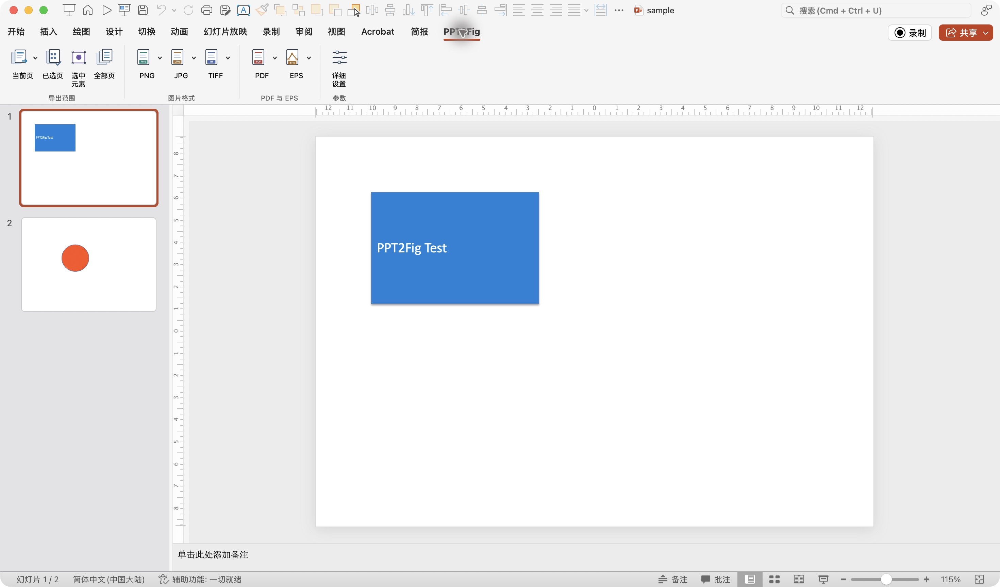
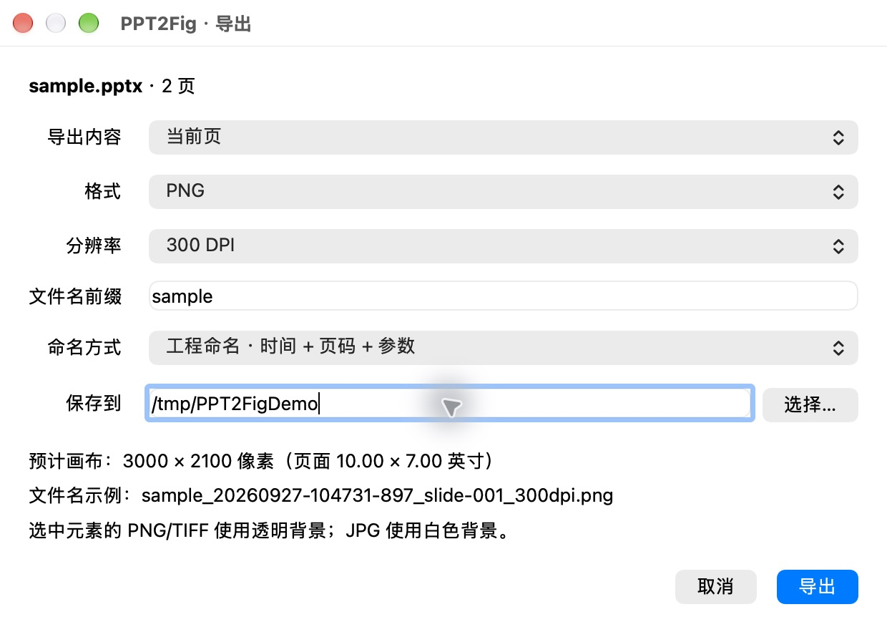

# PPT2Fig

**把 PowerPoint 页面和选中元素导出为科研、论文与工程文档可用的图片、PDF、EPS。** 支持自定义 DPI、像素尺寸、矢量 PDF、透明背景和批量页码；通过 PowerPoint 功能区操作，文件全程留在本机。

[English README](README.en.md) · [下载 v1.0.0](https://github.com/windycn/PPT2Fig/releases/tag/v1.0.0) · [许可证](LICENSE) · [第三方组件](THIRD_PARTY_NOTICES.md)

> **兼容性状态：** v1.0.0 已在 macOS PowerPoint 16.90 上完成部分真机验证。Windows 和 PowerPoint 2016/2021/2024/其他 Microsoft 365 构建仍需实机验收；请勿将它们视作已经验证的平台。详见[验收记录](#兼容性与验收)。

## 真机截图

以下截图取自 macOS PowerPoint 16.90 和本机辅助程序，演示文稿为仓库中的[公开测试样稿](qa/sample.pptx)。

## 能做什么

| 任务 | 选项 |
| --- | --- |
| 导出范围 | 当前页、已选页、指定连续或不连续页码（如 `1,3-5,8`）、全部页；单个元素、已组合元素、临时多选元素 |
| 图片 | PNG、JPG、TIFF；150/300/600/1200/2400 DPI 及 36–2400 自定义 DPI，也可按宽度或高度像素输出；导出前预览尺寸 |
| PDF | 保留 PowerPoint 矢量内容，或整页按指定 DPI 栅格化；多页合并或每页单独输出；页面尺寸与原 PPT 一致，不增加白边 |
| EPS | 每页或每组选中元素一个文件；尽量保留文字与图形矢量表示，透明等无法表达的效果可能被栅格化 |
| 文件管理 | 文件名可带日期时间、页码和分辨率；记忆上一次确认导出时的目录；避免覆盖已有同名文件 |

元素 PNG/TIFF 默认透明，JPG 使用白底。元素裁切依据 PowerPoint 形状几何边界并为阴影/发光留空间；特别复杂的效果可能需人工核对边界。矢量 PDF 没有“整页 DPI”概念，设置高 DPI 不会提升演示文稿原有位图素材的清晰度。EPS 的 DPI 只控制转换中需要栅格化的效果。极高 DPI 可能触发 2 亿像素画布限制，以避免过大的内存消耗。

功能区按**导出范围、图片格式、PDF 与 EPS、参数**分组，PNG/JPG/TIFF 和 PDF/EPS 各有独立图标及下拉预设。点击后可在本机窗口继续调整范围、格式、分辨率、合并方式、文件名和输出目录。

## 安装

需要桌面版 PowerPoint、Python 3.10 或更新版本和 Poppler 的 `pdftocairo`、`pdftops`、`pdfinfo`。发布页提供 `.ppam` 加载项；辅助程序从本仓库源码安装。当前没有免配置的一键安装包。

### macOS

1. 从[发布页](https://github.com/windycn/PPT2Fig/releases/tag/v1.0.0)下载 Source code 压缩包并解压，或克隆仓库。安装 [Poppler](https://poppler.freedesktop.org/)；Homebrew 用户可运行 `brew install poppler`。
2. 在解压后的项目根目录运行 `sh scripts/install_mac.sh`。脚本安装本机设置窗口及桥接程序，并用 `ppt2fig doctor` 检查依赖。
3. 在 PowerPoint 中打开 **工具 → PowerPoint 加载项… → 添加**，选择 `addin/PPT2Fig-v1.ppam`。若系统询问信任宏，只对自己核验来源的加载项启用。
4. 打开演示文稿，点击 **PPT2Fig** 选项卡。首次导出前可用仓库内 `qa/sample.pptx` 验证。

### Windows

1. 从[发布页](https://github.com/windycn/PPT2Fig/releases/tag/v1.0.0)下载 Source code 压缩包并解压，或克隆仓库。安装 Python 3.10+ 和带有 `pdftocairo.exe`、`pdftops.exe`、`pdfinfo.exe` 的 Poppler；将其 `bin` 目录加入 `PATH`，或设置 `PPT2FIG_POPPLER_DIR`。
2. 在 PowerShell 中进入项目根目录，运行 `.\scripts\install_windows.ps1`。安装脚本会运行依赖检查。
3. 在 PowerPoint 的加载项管理中添加 `addin\PPT2Fig-v1.ppam`，再用 `qa\sample.pptx` 验证。**Windows 安装与导出目前尚未完成实机验证**；如遇问题，请附 Office 构建号与错误信息提交 Issue。

安装脚本不捆绑 Poppler。macOS 上若用户已经自行构建 `dist/helper/ppt2fig`，脚本优先使用该文件；否则创建独立 Python 虚拟环境。Windows 脚本同样先检查本地构建，再回退到 Python 虚拟环境。未安装图形依赖时可手动运行 `python -m pip install -e '.[gui]'`；用 `ppt2fig doctor` 核验环境。

## 使用示例

1. 在 PowerPoint 中选定页面，或选中一个形状、组合或多个元素。
2. 点击 PPT2Fig 的 **PNG → 300 DPI**、**PDF → 原生矢量 → 多页合并**、**EPS → 效果栅格化 → 1200 DPI** 等入口，也可以打开**详细设置**。
3. 检查预计尺寸与文件名示例，选定目录，点击**导出**。下一次会默认使用上次确认导出时的目录；目录不存在时回退到“文稿”。

工程命名示例：`Figure_20260927-101530-123_slide-002_300dpi.png`。同一次批量导出使用同一时间标识，且不会覆盖已有文件。原稿不保存、不修改；转换以临时副本为输入，所有页完成后才写入目标目录。

## 兼容性与验收

| 平台 | 状态 |
| --- | --- |
| macOS PowerPoint 16.90 | v1.0.0 已实测加载项注册、10 个图标入口与菜单、设置窗口、带时间命名的 PNG 300 DPI 导出及原稿哈希不变；同一功能代码还验证了 PDF 矢量/2400 DPI 栅格设置、EPS 2400 DPI 设置、目录记忆、合并 PDF 与元素透明 PNG |
| macOS PowerPoint 2016、2021、2024、其他 Microsoft 365 构建 | 设计目标，未实机验收 |
| Windows PowerPoint 2016、2021、2024、Microsoft 365 | 设计目标，未实机验收 |

样稿测试中，两页矢量 PDF 页面为 720 × 504 pt，300 DPI 整页 PNG 为 3000 × 2100 px，元素 PNG 角点 alpha 为 0。宏接口、沙盒路径和本机桥接在各 Office 构建上可能有差异；特别是 PowerPoint 2016，需要在对应系统实测。发布 v1.0.0 表示当前代码与安装材料定版，不表示所有目标环境都已通过验收。

## 开发与组件

源码在 [`src/ppt2fig`](src/ppt2fig)，PowerPoint VBA 在 [`office/PPT2Fig.bas`](office/PPT2Fig.bas)，功能区定义在 [`office/ribbon.xml`](office/ribbon.xml)。`.ppam` 内含 PowerPoint 保存的 VBA 二进制与功能区资源；[`addin/PPT2Fig-source-v1.pptm`](addin/PPT2Fig-source-v1.pptm) 是生成加载项的宏源演示文稿，可用 `python scripts/package_ppam.py addin/PPT2Fig-source-v1.pptm output.ppam` 重新打包。单独的 `.bas` 文本不能直接生成 VBA 二进制。

辅助程序使用开源 [Poppler](https://poppler.freedesktop.org/) 转换 PDF/EPS/图片，[pypdf](https://pypdf.readthedocs.io/) 处理 PDF 页面，[Pillow](https://pillow.readthedocs.io/) 处理图像，[PySide6](https://doc.qt.io/qtforpython-6/) 提供本机窗口。代码采用 MIT 许可证；这些依赖各有独立许可，详见[第三方组件说明](THIRD_PARTY_NOTICES.md)。

运行测试：`python -m pip install -e '.[gui,test]'`，再运行 `python -m unittest discover -s tests -v`。当前测试覆盖核心转换，不替代目标 PowerPoint 版本的实机验收。欢迎通过 Issue 提交系统版本、Office 构建号、样稿结构、导出参数和可复现结果。
